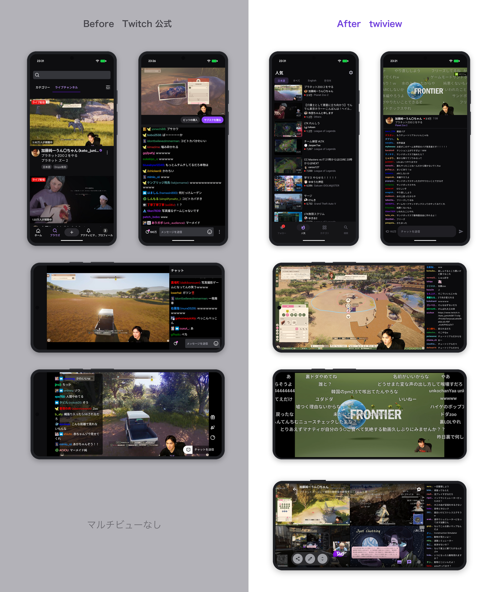

# twiview

[日本語](README.md) | English

An unofficial Android client that makes Twitch easier to watch.

> [!WARNING]
> **Unofficial app**, not affiliated with Twitch. Playback and search use Twitch's private web API, so a change on Twitch's side can break it any day. Use at your own risk.

## Before / After

Official app on the left, twiview on the right. Top: list and portrait. Middle: landscape (fixed chat width / danmaku fitted to the video). Bottom: multi-view (4 streams + chat).



## What it does

The playback features of the official app (speed, audio only, sleep timer, background playback, resume, PiP) are all here. On top of that:

- Dense lists. More on one screen
- Danmaku: chat flowing over the video
- Fine control over how chat looks (name truncation and alignment, badges, emotes, timestamps, line spacing, separators, deleted messages)
- Blocked words / users
- Low-latency mode that tightens the delay as far as the connection allows
- Landscape "fit to video" that maximizes the video while keeping chat
- Configurable gestures (skip amount, hold speed, left/right swipe)
- Bookmark favorites without signing in
- Automatic channel point bonus claiming
- Multi-view: up to 4 live streams at once (experimental)

**Browse**
- Channels you follow (needs a Client ID, see below) and in-app bookmark favorites (no login) as separate lists. Split into live / offline, sorted by viewers, start time, uptime or name
- Channel page with archives, a weekly schedule table like the real site, and clips (filter by period)
- Popular and search (categories live inside the search tab). Opens `twitch.tv` and `clips.twitch.tv` links directly
- UI in 10 languages (see below). Viewer counts, "5m ago" and dates follow the language too. The stream language filter offers the same 10

**Playback**
- Live and past broadcasts on the same screen. VODs get a seek bar and 10-second skips
- Low latency / normal / stable. Low latency reads the segment still being written and gets the delay down to the 2-second range (connection permitting)
- Quality: auto or 1080p to 160p. Landscape: fixed chat width or "fit to video". Picture-in-picture with play / pause and 10-second skip buttons
- Speed (0.5 to 2x), audio only, sleep timer, background playback (always / headphones only), resume where you left off (watched bar in the list)
- Double tap to skip, long press for fast playback (back to normal on release), vertical swipe for brightness and volume, horizontal swipe to seek. All configurable
- Multi-view tab: pick up to 4 live streams from your follows, popular or search; swipe up/down on a tile for its volume, tap one to make it large and switch the chat; three layouts. Experimental
- Ads work as in the official app. No ads on subscribed channels is a Twitch sub perk

**Chat**
- Font size, name color and truncation, badges, emotes, timestamps, line spacing, separators, deleted messages: all adjustable
- Danmaku, emotes included. Opacity, speed, size (relative to the screen height), area and max count
- Blocked words / users. You can post while signed in
- VODs replay the chat of the time in sync with playback

**Channel points**
- Watch points accrue (the app sends the same watch report as the official player). Bonuses are claimed automatically (still shaky, see below)

## Languages

日本語 / English / Português / Deutsch / Français / Русский / Español / Italiano / Türkçe / 한국어

Chosen to cover all of the top 14 countries by [Twitch users per country](https://worldpopulationreview.com/country-rankings/twitch-users-by-country) (World Population Review estimates) — about 86% of estimated users.

## Install

Android 8.0 or later. No iOS.

Install the APK from [Releases](https://github.com/s-tyd/twiview/releases). You need to allow installs from unknown sources.

To build it yourself, with JDK 17:

```sh
./gradlew :app:assembleDebug
adb install -r app/build/outputs/apk/debug/app-debug.apk
```

A self-built APK has a different signature, so it cannot be installed over the Releases APK or vice versa.

## Showing your follow list

Only the follow list goes through the official Twitch API (Helix), so you need your own Client ID.

1. Register an app in the [Twitch Developer Console](https://dev.twitch.tv/console/apps/create)
2. Enter the Client ID under Settings → Account → Client ID for follows

If you build it yourself, put it in `local.properties` and it becomes the default (not tracked by git).

```properties
twitch.clientId=xxxxxxxxxxxxxxxxxxxxxxxxxxxxxx
```

## Sign-in and your data

- You sign in on the real twitch.tv page, opened inside the app. The app never sees your password
- The token stays on the device: encrypted with Android Keystore, excluded from backups, sent only to Twitch
- Playback and search use the same public Client ID as the twitch.tv website. Your own Client ID is used only for the follow list
- Recent messages shown when you open a chat come from [recent-messages.robotty.de](https://recent-messages.robotty.de/) (only the channel name is sent)
- Signing out deletes the token and cookies

## Notes

- Low latency bottoms out at 2 to 3 seconds. Not down to the website or official app (about 1 second)
- Bonus auto-claim opens the twitch.tv popout chat in a hidden WebView and presses the button

---

Built mostly for myself, so the details are a bit rough. Feature requests and bug reports are welcome as Issues.
